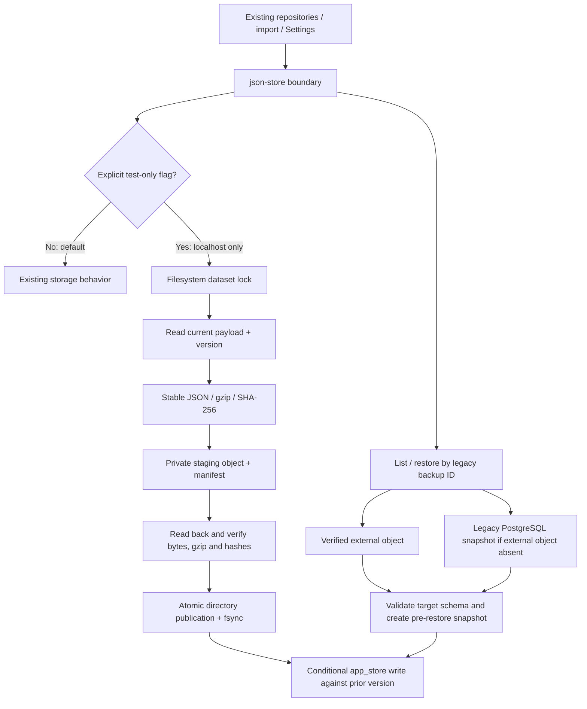

# SUPPER Phase 02 — External Snapshot Architecture & Safe Local Implementation

Verified 2026-10-15 (Asia/Bangkok). **PHASE_02_LOCAL_IMPLEMENTATION_PASS**. Production activation remains disabled. No Phase 03 cleanup, full migration, deletion or historical ticket archival was performed.

## Root cause and scope

Phase 01 measured approximately 1.42 GiB in supper_restore; app_store accounts for 99.3%. Its 6,085 full-dataset snapshots occupy approximately 1,381.215 MiB of stored JSON, while current business JSON occupies about 3.832 MiB. Each routine JSON write previously copied the entire prior array into another PostgreSQL row.

This phase adds a local, integrity-verified external snapshot boundary. Current business JSON remains in app_store. Ticket/customer/SLA/report/recurrence business rules and role permissions are unchanged. The existing writer remains the default because production activation was explicitly prohibited; the database storage problem is not claimed to be solved in production yet.

## Architecture



The local filesystem lock serializes participating writers across processes sharing one archive root. Conditional database writes reject version changes made by other writers. The actual Supabase SDK helpers use key + updated_at predicates; first writes use insert, not an overwrite-capable upsert. A failed conditional write preserves the verified snapshot and leaves the competing database value intact.

This is not a distributed transaction across multiple datasets. updateJson holds the lock across read/modification/snapshot/write and supports asynchronous updaters. Direct writeJsonAtomic retains its existing whole-dataset replacement contract. Existing import computation and multi-dataset rollback are not made globally atomic by this change. Production multi-host coordination remains a separate design requirement.

## Adapter contracts

Implemented under [src/lib/snapshots](../../src/lib/snapshots):

| Operation | Contract |
| --- | --- |
| saveSnapshot(input) | Save immutable JSON text and metadata; verify staged bytes from disk before publishing; return verified metadata. Same backup ID/input is idempotent. Conflicting content or immutable metadata fails. |
| getSnapshot(backupPath) | Return verified raw JSON text plus server-side metadata. Check identity, compressed size/hash, gzip CRC, decompressed size/hash and valid JSON. |
| listSnapshots() | List independently recoverable manifests without a PostgreSQL payload index. Ignore unpublished staging directories. Malformed manifests/layout fail rather than disappearing silently. |
| verifySnapshot(backupPath) | Perform full read-back verification and return metadata. |
| getSnapshotMetadata(backupPath) | Return metadata after full object verification, not a trust-only cache lookup. |
| deleteSnapshot(backupPath) | Always reject in Phase 02. There is no pruning implementation. |

`SnapshotStore` is provider-neutral. `LocalFilesystemSnapshotStore` is implemented and exercised against real files. `S3CompatibleSnapshotStore` is a future adapter interface only; no S3 SDK, credentials, bucket connection, queue or remote implementation was added.

The local adapter buffers objects up to 64 MiB compressed/uncompressed and rejects larger objects before a business write proceeds. Upgrade to streaming verification before accepting larger snapshots. This limit is explicit in code; no unbounded decompression is allowed.

## Metadata and serialization

Each manifest has a strict, versioned schema:

| Field | Meaning |
| --- | --- |
| metadataVersion / schemaVersion | Both 1 for this envelope; future versions require an explicit reader upgrade. |
| snapshotId | SHA-256 of the exact legacy-compatible backup path. |
| originalKey | Known active dataset key, validated against backup-restore-policy. |
| backupPath | Original logical backup identifier, preserved for Settings/import compatibility. |
| createdAt | Effective snapshot identity timestamp. Legacy samples use the timestamp encoded in their original backup ID; new automatic snapshots use the persisted source revision timestamp. This is not a separate wall-clock publication timestamp. |
| sourceVersion | Persisted source updated_at revision, preserved separately. |
| checksum | SHA-256 of the exact uncompressed UTF-8 JSON bytes. |
| compressedChecksum | SHA-256 of the gzip object bytes. |
| compressedBytes / uncompressedBytes | Exact payload byte sizes. |
| compression | gzip. |
| storageLocation | Relative server-side object location; never returned in Settings backup lists. |
| state | externally_verified; the directory becomes visible only after disk read-back passes. |
| category | automatic, manual, import or tombstone. |
| relatedImportBatchIds | Import dependencies known when captured/exported; sorted and deduplicated. |

Routine writes serialize JSON consistently with sorted object keys and preserved array order; non-JSON values are rejected rather than silently dropped. Historical migration accepts the original `value::text` directly, without parsing/reserializing it first. This preserves recoverable large-integer and high-precision numeric lexemes; a dedicated test covers values beyond JavaScript's exact-number range. Application restore still uses the application's existing JavaScript JSON/Zod contract.

An automatic backup identifier is deterministic for target + persisted revision + content checksum. A retry after successful snapshot publication but failed database write therefore does not create another snapshot. Import baselines include batch ID in that identity so the operation has an explicit protected recovery point even if an automatic retry snapshot already existed before the import started. No content-only global deduplication erases separate historical backup identities.

## Storage layout and publication

Local standard: `/Volumes/Vault/storage/{system-name}`.

Configured SUPPER archive parent: `/Volumes/Vault/storage/supper/snapshot-archives`.

Actual Phase 02 test namespace:

```text
snapshot-archives/
  phase02-20261015/
    objects/
      2026/01/imports/mappings/<snapshotId>/
        snapshot.json.gz
        manifest.json
      <year>/<month>/<dataset>/<snapshotId>/...
    locks/<datasetHash>/
  phase02-test-evidence.json
```

Directory year/month derive from the backup identity timestamp. Each snapshot directory contains its own recoverable manifest, rather than requiring a central index to locate metadata. A lost derived catalog can be rebuilt by scanning these directories; object + manifest must both be backed up. The layout intentionally publishes the two files together as one atomic directory.

Publication sequence:

1. Validate the logical backup path and JSON/size constraints.
2. Create a unique private `.tmp-...` directory beside the final object directory.
3. Write gzip and manifest with exclusive creation, mode 600, and fsync each file.
4. Reopen both staged files; validate identity, gzip, byte lengths and SHA-256.
5. Sync the staging directory, atomically rename to the immutable final directory, and sync its parent.
6. Reopen/verify the published object before returning success.

Directories must be private (mode 700) and not symlinks; object files must be private regular files. The adapter does not follow symlinked objects. Collision publication checks the existing verified object and refuses conflicting content. Caught failures remove only that invocation's unpublished staging directory. A process crash may leave staging/lock directories: these are not visible snapshots and are not automatically treated as safe to delete.

## Feature flag and safety boundaries

The committed `.env.example` sets:

```dotenv
SUPPER_EXTERNAL_SNAPSHOTS=0
SUPPER_SNAPSHOT_ROOT=
```

The new writer is permitted only when all of the following are true:

- SUPPER_EXTERNAL_SNAPSHOTS=1;
- NODE_ENV=test;
- VERCEL is absent;
- the configured data endpoint has a localhost/127.0.0.1/IPv6-loopback hostname;
- archive root is an absolute path outside the repository;
- selected business storage uses app_store.

Production and Vercel reject activation even if the flag is mistakenly set. A localhost URL alone does not prove which database backs a service; the integration harness separately checks the actual database name, accepts only supper_phase02_* as a write target, and enforces READ ONLY transactions for supper_restore. Do not point a future local API test at the recovery database.

No application environment file, Vercel setting or production backend was changed. The local adapter cannot be assumed accessible from Vercel. No snapshot payload/index is written to PostgreSQL by the experimental writer; a required external snapshot failure blocks the data write, without an unbounded PostgreSQL fallback queue.

## Settings restore and import rollback compatibility

- backupTarget's shared parser moved to backup-restore-policy and is re-exported from json-store, preserving existing callers and identifiers. Known-target and traversal checks remain enforced.
- listBackups merges/deduplicates legacy PostgreSQL keys with external manifest backup IDs, then applies the existing active-backend policy. Only logical IDs reach the frontend.
- Restore prefers a fully verified external object. A wholly absent external object may resolve to its still-present legacy PostgreSQL snapshot. An incomplete published object, bad manifest or checksum/gzip failure does not fall back silently.
- Validate the restored JSON against the target's existing application schema before any mutation. Validation does not apply defaults or strip original fields from the restored payload.
- Save a verified pre-restore snapshot before conditionally replacing only the requested dataset. Unrelated dataset keys are not overwritten. Settings admin authorization, CSRF/request handling and existing restore audit behavior are unchanged.
- restoreBackupSet keeps the existing earliest-snapshot-per-target rule and validates the complete selected rollback set before its first data change. Subsequent database/I/O failure can still leave a partially completed multi-dataset rollback; pre-restore objects permit recovery, but no global transaction is claimed. Follow-up production design must address that limitation.
- Current commitImport writes tickets/history/audit. Its experimental path now explicitly captures those three baselines with the batch ID, before writes, and records their paths alongside existing detected backups. It does not add an unrelated customer restore to an import that does not write customers. Ticket matching, customer calculations, SLA, report filtering and role logic are untouched.
- Historical import paths were exported with their actual batch references. All 67 paths are accounted for, retrieved and byte/hash-verified. All three currently completed import batches were rolled back successfully on the disposable working copy. The two already rolled-back batches' references remain protected and accessible as history.

### Rollback-reference lifetime

There is no automatic expiry in Phase 02. Preserve all 67 historical references, including references from rolled-back batches, until a formal retention decision exists. For future policy, review rollback eligibility after at least the reconciliation window (a proposed 90 days, not an implemented limit), while retaining immutable recovery/audit evidence longer according to contract/security obligations.

An old full-dataset rollback can undo changes made after the import; it is not a per-ticket inverse operation. Age alone cannot make it safe. Production should define eligibility, operator confirmation and dataset-version checks explicitly before enabling long-lived rollback. Revoking a reference requires a separately reviewed, versioned protection ledger; never mutate an immutable archived manifest to make it eligible for deletion.

## Retention selection, not pruning

`planSnapshotRetention` implements the proposed hot selection policy:

- latest two automatic snapshots per dataset, configurable through maxAutomaticPerDataset;
- configurable maxHotBytes, proposed default 50 MiB;
- count compressed payload plus serialized manifest bytes in the budget;
- preserve every manual/import/tombstone category and every explicitly protected/referenced path;
- report missing references and protectedOverBudget instead of dropping protected data;
- select additional automatic snapshots newest-first only if the count and byte limits allow them.

The result distinguishes retained (hot) from cold objects and always reports deletionEnabled=false. This is a bounded hot-set selection model, not an active eviction job or an operating PostgreSQL snapshot cache. All historical objects remain accessible; all original PostgreSQL rows remain intact. No pruning was activated, as explicitly prohibited for this phase. Filesystem allocation/block overhead is not represented by the logical object-byte budget.

Protected references can exceed the budget; the caller must surface that condition and revisit capacity/eligibility rather than silently deleting data. Protected count can exceed the automatic count limit by design. Tests demonstrate both count/byte enforcement and protected overflow.

## Non-destructive migration mechanism

`migrateSnapshot` exports one legacy snapshot; `migrateSnapshotSamples` accepts an explicitly bounded sample source (1–100 objects). There is intentionally no source-delete callback or unrestricted full-migration CLI.

For each source:

1. Read its original backup path, exact value::text, persisted revision and related batch IDs from a read-only source.
2. Save an immutable gzip object with versioned metadata.
3. Read it back and verify exact JSON text and SHA-256.
4. Record success through the independently published externally_verified manifest; return failed status for sample failures without logging payloads.

Resume by enumerating source keys and manifests: already verified IDs with identical content are idempotent; missing/failed IDs can be retried. A conflicting immutable object or corrupted existing object is an error for investigation, not permission to replace it. Persist operator progress outside Git if running batches later; the per-object manifests are the durable recovery checkpoint even if a separate progress report is lost. Manual/tombstone protection can be supplied on migration; no category authorizes deletion.

Only 71 representative existing snapshots were exported in this phase: all 67 import references plus large ticket/history/audit and auth samples. Full export of all 6,085 did not run. Original objects/rows were not modified or marked in PostgreSQL; verification state is external.

## Failure/retry handling

| Condition | Behavior |
| --- | --- |
| External filesystem unavailable/full/permission error | Abort before current data write. Do not fall back to storing a new large PostgreSQL snapshot. |
| Interrupted publication | No partially published snapshot is listed; retry the same source identity. A crash may require manual stale-stage review. |
| Duplicate same-ID retry | Verify existing content/metadata and return the same object. |
| Same ID, conflicting content | Reject; retain the original immutable object. |
| Competing dataset writers | Filesystem lock plus database compare-and-set; version conflict fails without overwriting the competitor. |
| Stale lock | Fail after a bounded five-second wait. Never steal a lock automatically; verify the old process is stopped before operator recovery. |
| Missing external snapshot with intact legacy source | Resolve the original legacy ID from PostgreSQL for compatibility. |
| Published object incomplete/corrupt/oversize | Fail closed; do not hide corruption with a legacy fallback. |
| Target payload incompatible with current schema | Reject before backup/data mutation; preserve archived bytes for investigation. |
| Audit write fails after successful restore | Existing restore-service warning/critical-log behavior remains; do not pretend data and audit are one transaction. |
| Protected objects exceed hot budget | Return the overflow condition; retain all required objects. |

## Security and future remote requirements

Snapshots include real customer content and historical authentication/password-hash JSON. Local objects are compressed, **not encrypted by this adapter**. Private filesystem permissions are enforced; Vault encryption-at-rest status was not verified. Do not treat gzip or SHA-256 as encryption/authentication, and do not copy these files into Git or a public share.

Before production S3-compatible implementation:

- use durable remote storage with encrypted transport and server-side or authenticated client-side encryption under managed keys;
- keep credentials only in server-side secret management; use least-privilege scoped credentials and no automatic delete privilege;
- immutable conditional object creation, encrypted/versioned manifests and publish-last commit semantics equivalent to the local atomic directory;
- integrity-check decrypted/uncompressed bytes, bounded compressed/uncompressed reads and strict identity/schema validation;
- object versioning/retention, independent disaster-recovery copies, tested restore drills and reconciliation for orphan payloads/failed index publication;
- production-safe concurrency/versioning independent of a shared local filesystem;
- current role/customer authorization before retrieval; preserve safe error responses and keep physical locations/credentials off frontend responses;
- a compact metadata/catalog only, never another PostgreSQL copy of historical payloads;
- clear capacity, remote-unavailability, recovery-point and legal retention rules before any source removal.

The future interface is intentionally not a pretend working S3 adapter. No real external provider was contacted in this phase.

## Test environment and evidence

Working copy created as supper_phase02_20261015 from supper_restore within the existing local PostgreSQL container. Only the copy receives integration writes. The source is protected by read-only test queries. Tests use a PostgreSQL app_store shim to exercise the real json-store/filesystem boundary without installing or starting a Supabase HTTP service.

Commands:

```sh
npm test

# Explicit local integration; create/inspect the named isolated copy first.
SUPPER_PHASE02_INTEGRATION=1 \
SUPPER_PHASE02_DATABASE=supper_phase02_20261015 \
SUPPER_PHASE02_ARCHIVE_ROOT=/Volumes/Vault/storage/supper/snapshot-archives/phase02-20261015 \
npx vitest run src/lib/snapshots/local-database.integration.test.ts

npm run verify:architecture
npm run verify:migrations
npm run verify:runtime-assets
```

Integration is skipped by default and rejects a non-Phase-02 write database. Never substitute supper_restore in an integration write command. The original recovery database and its 6,085 snapshot rows were checked before/after; all 17 current payload fingerprints remain unchanged. Final source counts: 6,102 app_store rows, 1,328 tickets, 30 customers and 5,955 history records. Working-copy business payloads were returned to their own baseline after exercising rollback; no source snapshot rows were removed.

| Verification | Result |
| --- | --- |
| Default test suite | 195 passed; opt-in real-database integration skipped by default. |
| Real isolated PostgreSQL integration | 1 passed separately. |
| Existing snapshot samples | 71/71 exact read-back and SHA-256 checks, repeated export/idempotency. |
| Historical import paths | 67/67 accounted for and retrieved; all 3 completed batches rolled back in the copy. |
| New import baseline references | All 3 datasets carry the explicit batch ID. |
| JSON/Thai/decimal round-trip | PASS; exact legacy numeric text preservation tested separately. |
| gzip CRC, compressed/content SHA-256 | PASS, including corruption with an updated compressed hash. |
| Atomic publication / interruption / concurrent duplicate | PASS with real filesystem and injected interruption. |
| Concurrent updates / asynchronous updater / database CAS | PASS. |
| Missing object / disappeared gzip / corrupt manifest / symlink / size bound | PASS. |
| Listing / Settings admin restore / audit / wrong-target schema | PASS. |
| Retention latest-two, byte budget, protected overflow | PASS; no pruning. |
| Changed-file lint | PASS with zero warnings. |
| Architecture / migration inventory / runtime assets | PASS; no SQL migration added or applied. |
| Production source + new Phase 02 tests typecheck | PASS using a temporary config excluding unrelated old test fixtures. |
| Unfiltered full-repository typecheck | Still fails on existing domain.test.ts, sla.test.ts, observability.test.ts and proxy.test.ts fixture/type issues; these files were not modified. |

The installed test runner initially lacked its optional Apple Silicon binding. node_modules was repaired without changing package.json declarations or the pre-existing package-lock.json diff. No new runtime dependency was introduced.

Private aggregate evidence: `/Volumes/Vault/storage/supper/snapshot-archives/phase02-test-evidence.json`. After repeated integration runs there are 107 cumulative test objects: the 71 historical samples plus generated safety/rollback snapshots, approximately 12.18 MiB compressed payload plus 85.4 KiB manifests. This is not a full-migration total or achieved database reduction. Fault-injection unit tests use synthetic temporary directories, not the historical sample archive.

## Changed files

- snapshots/store.ts: contracts, metadata schema, stable identity/serialization.
- snapshots/filesystem.ts: private atomic local adapter and local dataset lock.
- snapshots/runtime.ts: strict test-only activation, writer/retrieval/validation helpers.
- snapshots/retention.ts: bounded hot-set selection and protected-reference reporting.
- snapshots/migration.ts: exact, resumable per-object export/sample verification.
- json-store.ts: opt-in external writer/list/restore and protected import baselines; default behavior preserved.
- store.ts: conditional versioned persistence helpers.
- backup-restore-policy.ts: shared existing backup-ID parser; json-store re-export preserves callers.
- excel-import.ts: explicit baseline capture/reference registration only in the experimental path.
- .env.example: disabled feature flag and external-root placeholder.
- snapshots/snapshots.test.ts, snapshots/local-database.integration.test.ts, json-store-snapshots.test.ts, store-version.test.ts: required integrity/concurrency/compatibility tests.
- This architecture document. Phase 00/01 documents and recovery script remain available; they were not new Phase 02 implementations.

## Storage estimates and readiness

**Actual database reduction in Phase 02: zero.** All existing app_store snapshots remain. Experimental future writes place backups externally rather than creating additional PostgreSQL payload rows. The original 1.42 GiB recovery footprint is intentionally retained.

Phase 01 estimated that externally storing most snapshots could avoid approximately 1.35–1.42 GiB of compacted database allocation. A hypothetical latest-two-plus-import retention selection retained 90 legacy rows / 10.423 MiB; a hosted active database with a small catalog/index and bounded snapshots was estimated around 80–120 MiB. Those remain estimates, not an after-migration measurement. Source removal and physical reclamation require separate planning/approval, capacity for maintenance and before/after measurements.

Ready for a separately authorized Phase 03 controlled export design/dry run. Not ready for production cutover or source deletion: remote adapter/encryption/durability, real Supabase HTTP compatibility, multi-host/multi-dataset failure semantics, legal retention/rollback lifetime, full-repository type errors, and the Phase 01 date/report/reference anomalies remain unresolved. No closed-ticket archival or automatic Phase 03 work begins from this document.
