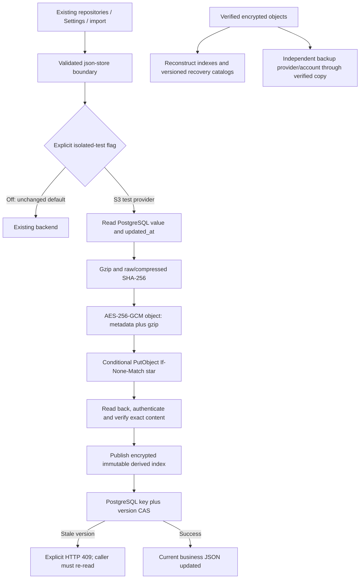

# SUPPER Phase 04A — Remote Snapshot Readiness

> **Current direction (2026-10-16):** Owner selected local Vault snapshot authority. This document retains Phase 04A/remote Phase 04B historical evidence. Supabase S3 incompatibility is no longer the active deployment blocker. See [LOCAL_VAULT_READINESS.md](LOCAL_VAULT_READINESS.md) for current architecture, safeguards and outstanding local/application integration gates.

Executed 2026-10-15, Asia/Bangkok. **PHASE_04A_LOCAL_PASS**. Actual AWS S3 and Cloudflare R2 validation remains **PENDING**. **Production migration, activation, deployment and cutover have not started.**

## Baseline and boundaries

Read AGENTS.md and all four preceding recovery reports. Phase 03 measured 14.22 MiB in the optimized PostgreSQL clone, with 17 unchanged current JSON datasets. The authoritative historical migration set is the frozen **6,085-entry** `/Volumes/Vault/storage/supper/snapshot-archives/phase03/full-manifest.json`, not a directory listing. The directory also contains 90 append-only Phase 03 test objects. Neither set was uploaded to MinIO or an external provider in this phase.

Protected `supper_restore`, the optimized Phase 03 database, original downloaded backups and original snapshot objects were not modified. No closed-ticket archival, production Supabase access, R2/AWS object access or Vercel production setting change occurred. PostgreSQL writes were confined to the newly created **`supper_phase04a_synthetic_20261015`** database. MinIO tests use random namespaces in synthetic-only buckets. Privileged corruption/deletion fault injection affects only new synthetic fixtures; SnapshotStore deletion remains disabled.

Local JSON login credentials were changed separately at the user's explicit request. Those changes do not affect recovered database authentication datasets or activate a remote backend. No credential value is included in this report.

## Architecture and implementation



New files:

- `src/lib/snapshots/s3.ts`: AWS SDK v3 adapter implementing the existing SnapshotStore contract, paged listing, immutable publication, read-back verification, index reconstruction and versioned recovery catalogs.
- `encryption.ts`: versioned AES-256-GCM envelope with key IDs and authenticated bucket/object identity.
- `s3-config.ts`: server-only, explicit endpoint/credential/keyring configuration; TLS required except localhost tests.
- `remote-migration.ts`: strict frozen-set loader and bounded, idempotent verified migration/copy with checkpoint callbacks.
- Unit and opt-in MinIO integration tests; `docs/recovery/policies/aws-snapshot-writer.example.json` is an unapplied policy template.

Modified shared boundaries:

- `runtime.ts` selects filesystem or remote SnapshotStore and reuses a client for identical server configuration. Configuration changes replace/destroy the old client; rotate credentials through a controlled instance restart/drain, not live process-environment mutation.
- `json-store.ts` uses the shared coordination boundary. Remote writes use database CAS rather than filesystem or in-memory locks. Business repositories contain no provider-specific storage code.
- `store.ts` returns a typed 409 on a stale version/duplicate first insert, and a separate failure on other database errors.
- Snapshot metadata adds optional `storedBytes`, preserving old filesystem manifests. Remote values account for the exact encrypted payload size; retention adds a conservative encrypted-index overhead.
- Retention adds a global count budget while preserving existing per-dataset and byte budgets.
- AWS SDK `@aws-sdk/client-s3` **3.1152.0** and its lock entries were added. Pre-existing lockfile deletions were retained.

The adapter uses single-object PUTs, bounded to 64 MiB raw/compressed payloads, bounded metadata and response streams. No multipart uploader, public ACL, presigned URL or automatic pruning was added. Settings receives original logical backup IDs rather than public object URLs.

## Immutable publication and resumability

For a configured private prefix:

```text
<prefix>/objects/<sha256(originalBackupId)>.snapshot
<prefix>/index/<sha256(originalBackupId)>.manifest
<prefix>/catalogs/<sha256(catalogPlaintext)>.manifest
```

The encrypted object contains its complete manifest and original gzip payload. It is self-describing after authenticated decryption. The small encrypted index is derived and only published after full payload read-back verification. Losing an index does not lose a snapshot; `reconstructManifests()` verifies the objects before recreating missing index entries. A corrupted existing immutable index is not overwritten: recover into a fresh verified namespace and publish a replacement catalog instead.

Every payload, index and catalog uses `PutObject` with `IfNoneMatch: "*"`. A 412 is accepted only after the existing object is authenticated and its logical metadata/content match exactly. Different content under the same original backup ID fails. A lost successful-PUT response therefore resumes through a conditional conflict and verified read, without replacement or duplication. All reads authenticate identity and verify lengths, gzip integrity, compressed SHA-256, raw SHA-256 and valid JSON before returning a restore payload. A malformed/authentication/checksum failure never falls back to a legacy copy; only a true missing-object response can use the existing legacy PostgreSQL compatibility lookup.

Retries use bounded exponential backoff with jitter: four attempts by default, at most five when explicitly configured, at most one second backoff and a ten-second request deadline per attempt. SDK internal retries are set to one attempt by the configuration factory. Transient network failures, 408, 409, 429 and 5xx are eligible; 403, corruption and immutable-content conflicts are not blindly retried. A failed snapshot/index publication prevents the business CAS write. Orphaned verified objects are retained for reconciliation; no cleanup runs automatically.

`migrateManifest()` reads one source payload at a time and re-reads the destination before reporting progress. Its callback allows persisted checkpoints; durable objects themselves make a complete re-scan/retry safe even if a checkpoint was interrupted. The integration test persists a checkpoint, interrupts after a verified object, resumes and excludes an extra non-manifest object. For an actual historical migration, first compare the frozen manifest's file SHA-256 with the Phase 03 result evidence, then call `parseFrozenHistoricalManifest()`: it requires exactly 6,085 unique valid identifiers. Pass that set explicitly, never `listSnapshots()` over the Phase 03 directory. Checkpoints must be written atomically and fsynced by the future migration runner; they are advisory, not permission to skip destination integrity checks or delete source data.

`publishRecoveryManifest()` verifies selected objects and publishes an encrypted content-addressed catalog; `getRecoveryManifest()` checks its identity/hash and schema independently. Original backup IDs remain resolvable through the object mapping and catalogs. No real historical migration was run here.

## Cross-instance concurrency and limits

Remote code does not acquire a local filesystem lock or depend on an in-memory mutex. The coordination authority is PostgreSQL: update only the row matching both key and the version read before snapshot publication. Successful writes advance updated_at even within a millisecond. The primary-key constraint protects simultaneous first inserts. A competing writer cannot silently replace a revision after reading stale state; it gets 409 and must re-read/recompute. Business callbacks are not automatically replayed because they can have side effects.

Tests cover independent S3 clients and real PostgreSQL predicates for ticket, customer and audit datasets. For each race, one writer succeeds, the stale writer receives a conflict and an explicit rebase preserves both updates. A separate eight-process psql race proves one successful conditional update and seven rejected stale updates, without shared JavaScript state or locks. The actual Supabase SDK key/version predicates also retain their unit coverage.

**Remaining atomicity gaps:** ticket/history/audit/customer recalculation side effects and imports/rollback span multiple datasets and are not one transaction with object storage. Rollback preflight verifies every selected payload before the first mutation, but a later database failure can still leave partial progress. A customer MD calculation derived from tickets can become stale across datasets. An ambiguous committed database response also requires operation-level reconciliation; snapshot idempotency alone does not make a business request idempotent. Before multi-host staging activation, review a database transaction/RPC or outbox/reconciliation design, operation IDs, failure recovery and derived-data recalculation. Freeze every legacy writer during cutover because unconditional legacy upserts bypass this protection.

This is a local concurrency proof, not a claim that Vercel multi-region behavior, PostgREST transport, deployed API error handling or a browser UI race has been exercised. Those are Phase 04B gates. The recovery schema has no app_store timestamp trigger; new staging must verify that its schema preserves the version predicate semantics.

## Encryption and server security

Objects **and** indexes/catalogs use application-level AES-256-GCM. The envelope stores format version, non-secret key ID and a fresh 96-bit CSPRNG nonce. The authentication tag covers ciphertext, header and exact bucket/object context. It protects sensitive historical user/password-hash JSON, tickets and attachments even from a bucket-only reader. Gzip is compression; SHA-256 is an integrity checksum; neither replaces authenticated encryption.

Keys must be independently generated 32-byte values and kept in a server secret manager, not Git, browser configuration or object storage beside ciphertext. `server-only` prevents accidental client imports. Unit tests mock that Next.js bundler marker in the Node test environment; production module boundaries remain enforced. The SDK factory never falls back to an ambient AWS profile/credential chain: endpoint, credentials and keyring are explicit. HTTPS is required for real endpoints; plaintext HTTP is permitted only for loopback test endpoints.

Key rotation: add the new key version, keep old keys available, switch the active ID for new objects, drain/restart instances and verify old/new reads. Existing immutable objects remain under their original encryption key. Do not retire a key while any retained object/catalog uses it. If re-encryption is needed, copy verified content into a fresh namespace with a new catalog and independent backup before a separately approved retirement. Back up the keyring under independent encrypted escrow with dual-control recovery and a tested access procedure. Lost encryption keys make otherwise healthy objects unrecoverable. Credential rotation is separate: provision a replacement scoped credential, deploy/restart staging, verify read/write/negative-access tests, then revoke the old credential.

Private bucket requirements:

- No public access, website endpoint or anonymous read. MinIO anonymous object GET returned 403 in integration.
- Application identity gets only prefix-scoped ListBucket, GetObject and conditional PutObject. No delete, version deletion, bucket administration or public-ACL authority.
- Separate operator identity controls lifecycle, replication and recovery; the test harness alone has privileged synthetic-fixture fault-injection authority.
- AWS: configure Block Public Access, default encryption, versioning and reviewed Object Lock/retention settings as appropriate. If bucket-default SSE-KMS is selected, grant the specific KMS operations needed and test them; the adapter does not send AWS-only SSE headers to R2.
- The policy JSON beside this report is an AWS example requiring resource substitution and staging validation, not a deployed policy or proof of R2 IAM support. Enforce conditional publication and deny deletion at the storage boundary in addition to application checks.

## Adapter compatibility: measured versus pending

| Provider | Evidence | Remaining validation |
| --- | --- | --- |
| Local MinIO | Actual save/read/pagination/412 conflicts, concurrent clients, encryption/rotation, network reset, corruption, reconstruction, backup copy and restore tests passed | Synthetic test identity is privileged for fault injection; production least-privilege configuration is separate |
| AWS S3 | SDK v3 implementation follows documented conditional PUT semantics | Actual bucket, region, IAM, TLS, KMS/default encryption, versioning/lock, throttling and failure behavior **not tested** |
| Cloudflare R2 | Official S3 documentation states atomic If-Match/If-None-Match evaluation and 412 for losing conditional creates | Actual authorized R2 request, token scope, endpoint, negative permissions, rate limits and failure behavior **not tested** |

AWS documents conditional writes and policy enforcement in [conditional writes](https://docs.aws.amazon.com/AmazonS3/latest/userguide/conditional-writes.html) and [enforcement](https://docs.aws.amazon.com/AmazonS3/latest/userguide/conditional-writes-enforce.html). R2's [S3 compatibility table](https://developers.cloudflare.com/r2/api/s3/api/) documents the conditional headers but does not support S3 bucket versioning or AWS KMS/Object Lock headers. Do not copy an AWS configuration blindly to R2. R2 has its own [bucket locks](https://developers.cloudflare.com/r2/buckets/bucket-locks/) and [provider encryption at rest](https://developers.cloudflare.com/r2/reference/data-security/). Review provider token granularity: a bucket-scoped read/write token must not be assumed to exclude delete; bucket protection and operator separation are additional gates. Application encryption and content-addressed catalogs provide portable protection/versioning of recovery manifests, not provider-side versioning of arbitrary overwrites.

The SDK uses required-only transport checksum options for cross-provider compatibility; independent authenticated read-back/SHA checks remain mandatory. No R2/AWS credentials were used and no customer object was transferred outside the machine.

## Durability and disaster recovery

Production design: primary private snapshot bucket plus an independently controlled backup account/provider/region, with separate credentials, protection policy and recoverable encryption-key escrow. A second bucket on the same MinIO instance proves the copy mechanism only; it is **not** an independent failure domain.

Use the verified manifest-driven copy path for independent backups. Bucket-bound authenticated encryption requires decrypt/verify/re-encrypt during a cross-bucket copy; a raw S3 CopyObject is not sufficient. Keep original IDs, source revisions, timestamps, categories/import references and raw-content SHA-256. Publish and verify a versioned recovery catalog on both sides. Monitor replication lag and do periodic full verification from the authoritative catalogs, plus protected import/manual/tombstone references. Do not infer integrity from object existence or ETag.

Recovery sequence:

1. Stop affected writes/restores; preserve the failing namespace and logs. Do not replace a corrupt object in place or suppress a failed hash check.
2. Recover the correct keyring through controlled escrow; verify a catalog's hash/format and its object IDs.
3. Read and verify the independent backup. Copy selected verified entries to a **new** private namespace with `migrateManifest()`.
4. Verify all raw hashes, import references and recovery catalog; reconstruct derived indexes from verified objects where necessary.
5. In an isolated application context, exercise Settings restore, import rollback, authorization/audit and current-data consistency.
6. Change the active namespace only through the separately approved recovery/cutover procedure, with rollback evidence and monitoring. Keep the original namespace unchanged.

The local test corrupted one synthetic primary object and removed another, then recovered all three selected objects from the second bucket into a fresh namespace with original IDs/hashes. It also removed/rebuilt a derived index. Real provider/account outage recovery, offline key escrow and full 6,085-object remote DR remain untested. Proposed staging targets are RPO <=15 minutes and RTO <=2 hours; these are **planning goals, not measured guarantees**.

## Retention planner

`planSnapshotRetention()` enforces a global hot count (default 100), automatic per-dataset count (default 2) and hot byte budget (default 50 MiB). Remote accounting includes actual encrypted object bytes plus a conservative upper bound for its encrypted index; versioned catalogs/provider billing overhead must be monitored separately.

Manual snapshots, import category/related batch IDs, tombstones, explicit references and explicit protected history survive even a zero budget. Protected overflow is reported rather than pruned; missing references are surfaced. Always protect the frozen 6,085 historical IDs and all live import references when planning history placement. `cold` means a placement recommendation, **not permission to delete**. Both adapters reject delete; no lifecycle deletion, pruning worker or automatic retention activation exists.

## Local test infrastructure and reproduction

All infrastructure files are under `/Volumes/Vault/storage/supper/phase04a`, following the system storage convention. MinIO binds **127.0.0.1:19000**; its browser is disabled and update checks are disabled. It uses a dedicated bridge with outbound IP masquerading disabled. The development application on port 3000 uses local JSON with the snapshot feature flag off. At final handoff its previously stopped dev server was restarted in explicit local-json mode; health/login/authenticated-dashboard HTTP checks passed.

Public MinIO image pulls were rejected and old official binary URLs returned HTTP 410. Built the official source tag `RELEASE.2025-10-15T17-29-55Z` using Go 1.24.8, as supported by the [official source/release instructions](https://github.com/minio/minio/releases). Build evidence records module `v0.0.0-20251015172955-9e49d5e7a648`, checksum `h1:6TdolSCLSs2nwm8i0PpWDqf9iX2Ty9WQK8wmr7dCnUM=`. The binary reports DEVELOPMENT.GOGET because go install did not inject release display flags; the module identity is recorded instead of claiming that display string is a release verification.

Reproduce a fresh build (existing cache may be reused):

```sh
docker run --rm \
  --mount type=bind,src=/Volumes/Vault/storage/supper/phase04a/minio-build,dst=/build \
  -e GOBIN=/build/bin -e GOMODCACHE=/build/modules -e GOCACHE=/build/cache \
  -e CGO_ENABLED=0 -e GOMAXPROCS=2 -e GOFLAGS=-p=2 \
  golang@sha256:3d78beb141d98f42337f1252ecf2a5f20374109929a4c3f6817f9e4179cc0ae5 \
  go install github.com/minio/minio@RELEASE.2025-10-15T17-29-55Z
```

The private mode-600 `minio.env` contains only synthetic root credentials plus MINIO_UPDATE=off and MINIO_BROWSER=off. For a new setup, generate random local-only credentials into this file without printing or committing them. Start the existing named container with `docker start supper-phase04a-minio`. Initial creation used:

```sh
docker network create --driver bridge \
  --opt com.docker.network.bridge.enable_ip_masquerade=false supper-phase04a-local
docker run -d --name supper-phase04a-minio --network supper-phase04a-local \
  -p 127.0.0.1:19000:9000 \
  --env-file /Volumes/Vault/storage/supper/phase04a/minio.env \
  --mount type=bind,src=/Volumes/Vault/storage/supper/phase04a,dst=/phase04a \
  golang@sha256:3d78beb141d98f42337f1252ecf2a5f20374109929a4c3f6817f9e4179cc0ae5 \
  /phase04a/minio-build/bin/minio server /phase04a/minio-data \
  --address :9000 --console-address :9001
```

The synthetic PostgreSQL database was created fresh, not cloned from customer data, with only an app_store table (`key text primary key, value jsonb not null, updated_at timestamptz not null default clock_timestamp()`). The integration harness hardcodes this disposable database and cannot target recovery databases. It seeds only synthetic values. Do not rerun CREATE DATABASE against an existing name or substitute a recovery database.

```sh
npm test
npx tsc --noEmit --incremental false
SUPPER_PHASE04A_INTEGRATION=1 ./node_modules/.bin/dotenv \
  -e /Volumes/Vault/storage/supper/phase04a/minio.env -- \
  npx vitest run src/lib/snapshots/s3.integration.test.ts
npm run verify:architecture
npm run verify:migrations
npm run verify:runtime-assets
```

Tests use random prefixes and ephemeral synthetic encryption keys. Old test objects are disposable fixtures, not recoverable business history; never include these buckets in a historical migration manifest. The privileged fixture controller alone can inject corruption/delete synthetic test objects; neither SnapshotStore has a delete implementation.

## TypeScript and regression results

All five prior diagnostics were fixed without suppression or weaker types: explicit category/ticketLogs/slaPauses fields in the domain fixture; explicit category in the SLA fixture; `BigInt(...)` constructors preserving BigInt logging tests under the existing ES2017 target; exact NextRequest constructor init type in the proxy helper. No business calculation or request policy was changed.

Final results are recorded in the acceptance section below. The previously opt-in Phase 02/03 full migrations were not rerun against already-compacted databases. Their local filesystem compatibility is covered by the ordinary snapshot/json-store tests; their historical migration evidence remains preserved.

Dependency audit currently reports **21 alerts: 1 critical, 14 high, 6 moderate**. The critical alert includes the existing pinned Next.js dependency; no AWS SDK package is listed as affected in this audit. No `npm audit fix`, framework upgrade or unrelated dependency refactor was performed. Review and resolve applicable runtime advisories before staging exposure/production approval; a passing typecheck or storage test does not resolve those alerts.

## Phase 04B staging requirements

No stage below has been activated. Required operator/engineering work:

1. Provision a private **staging** bucket and independent backup destination; configure protections and least-privilege identities. Validate positive and negative access, actual conditional 412 behavior, TLS, pagination, checksum/encryption and provider failure behavior with synthetic fixtures first. Never use production credentials for this validation.
2. Provision staging secrets: SUPPER_S3_ENDPOINT, REGION, BUCKET, PREFIX, PATH_STYLE, ACCESS_KEY_ID, SECRET_ACCESS_KEY, SUPPER_SNAPSHOT_KEYS_JSON and ACTIVE_KEY_ID. R2 uses its account endpoint/region auto; AWS uses the selected regional endpoint/region. Keep all snapshot secrets server-only. Maintain an inventory of key IDs and recoverable escrow separately from storage credentials.
3. Provision a new Supabase staging project. **Do not restore the full cluster dump over it.** Review/export only application-owned public schema/data; preserve new managed auth/storage/realtime/vault schemas, roles, service migrations and project encryption material. Apply the reviewed app_store/security RPC migrations in their defined order; verify privileges/RLS, rate-limit RPC, constraints and updated_at CAS semantics. Import only approved current datasets using parameterized writes, then compare all 17 hashes/counts and report exceptions. Never copy source role/event-trigger/managed-schema definitions blindly.
4. Separate staging data/auth/session secrets from production. Exercise real Supabase HTTP/SDK CAS across multiple processes and actual Vercel instances, first-insert collisions, timeouts and partial failures. Review transaction/outbox and recovery behavior for imports, audit/history and customer recalculation before multi-host writer activation.
5. Configure a Vercel preview/staging deployment with approved staging endpoints. **Current runtime deliberately rejects VERCEL/non-test activation.** A separately reviewed activation gate/code change is required; do not bypass it by pretending a deployment is NODE_ENV=test. Production flags remain off.
6. Move Settings listing to use remote pagination through the application API/UI before activation. The adapter exposes pages, but the legacy listBackups caller still requests the full list. Fetching thousands of encrypted index objects serially can exceed serverless latency limits; benchmark and implement bounded/paged application retrieval in staging. Do not claim a local small-fixture test proves full-history UI performance.
7. Resolve the Monthly Report Factory/runtime asset blockers below, dependency advisories, backup/key recovery rehearsal, alert routing and a reviewed maintenance/rollback plan. Obtain separate authorization before transferring any real customer historical data.

## Snapshot and database migration runbook for future review

Start with synthetic staging. For a separately authorized real migration, capture source current revisions and freeze legacy writers during the final window. Verify the frozen manifest hash/count, all 67 referenced paths and source-object hashes; export only those 6,085 IDs to an approved namespace. Persist checkpoints, resume by immutable verification, produce/verify remote and independent backup catalogs, and scan every selected object. Extra Phase 03 test objects must not enter the set. Do not delete any source snapshot in this phase or use a checkpoint alone as cleanup authorization.

For the application database, use the reviewed application-schema/data strategy above, not the full cluster backup. Verify service-owned objects are unchanged, application migrations/RPCs work, every current payload hash/count matches approved baseline, and known anomalies/report exceptions are retained. Reconcile a final delta under maintenance/read-only mode. Reject cutover if unverified objects, missing references, hash mismatches or legacy writers remain.

Rollback plan must preserve the pre-cutover application data export, reviewed schema version and deployment. A legacy reader cannot simply be re-enabled after its PostgreSQL snapshot rows are absent; restore required verified snapshot rows into a disposable/staging recovery context or restore the reviewed application backup under maintenance. Reconcile writes committed after cutover, validate current hashes/import references and authorization/audit, then reopen only after acceptance. The original full dump remains a local disaster-recovery artifact, not a managed-project deployment script.

## Monthly Report Factory and missing generated assets

Read-only inventory from actual source/files:

| Asset/state | Measured status | Deployment implication |
| --- | --- | --- |
| templates/reports/manday-summary-template.xlsx | 1,282,144 bytes; SHA-256 `6bf1c606328e38e0af6b10a90a0ca6ea6702a0d0c4226546711b0d8d36ffefd9` | Include read-only in runtime bundle or a verified asset source |
| templates/reports/support-service-monthly-report-template.xlsx | 4,215,183 bytes; SHA-256 `42c3a78481508c16656e082d55bbc0ec3a8ad989b9c175788bffbaccd3440c5b` | Same requirement; worksheet names/calculation behavior must remain valid |
| data/reports/monthly | 2 period batches, 22 files, 104,842,875 bytes: 11 JSON, 10 XLSX, 1 PDF | Existing host files are not in PostgreSQL snapshots and must not be assumed to survive serverless deployment |
| Monthly source workbooks | monthly-review.xlsx, cr.xlsx, inc.xlsx, sr.xlsx | Require private durable storage and upload lineage |
| Monthly normalized JSON/state | Four normalized datasets, batch.json and export-history.json | Require durable shared storage/concurrency; current source writes process.cwd()/data |
| Monthly outputs | XLSX and PDF in period/project/export directories | Require durable private output storage and authorized retrieval |
| PDF conversion | Source uses LIBREOFFICE_PATH or soffice/libreoffice; macOS app candidate absent; PATH CLI version probe passed: LibreOfficeDev 26.8.0.0.alpha0 | Native PDF rendering and staging worker packaging remain unverified |
| Recovered PPTX report jobs | 5 jobs, only 1 generated payload; 4 missing payloads; 2 missing current customer-key matches | Existing recovery exceptions, not repaired or dropped |

Monthly Report Factory (`monthly-report-factory.ts`) is a filesystem-oriented Excel/PDF pipeline. Separately, `report-generator.ts` and `report-storage.ts` persist generated PPTX assets through app_store/relational storage. The snapshot adapter does not migrate these systems or make mutable report directories durable. Existing local XLSX/PDF files are not presumed to replace missing PPTX job assets.

Before staging, create a private reconciliation register for every missing generated job asset: original job/customer/month/output identity, checksum if recoverable, recovery source and owner-approved disposition. Recover original binaries from a verified source or explicitly mark them unavailable; regenerate only with approved inputs/semantics and a new lineage record. Resolve the two customer-reference gaps through review, not silent reassignment. Inventory/upload of actual report sources/outputs and native PDF conversion needs separate approval/testing; no real reports were uploaded, regenerated or altered here.

## Proposed monitoring gates

These thresholds are recommendations, not installed alerts:

- Any authenticated-decryption/hash failure, missing protected/import reference or unverified migration entry: critical, stop restore/cutover and investigate.
- Backup copy lag >15 minutes warning, >1 hour critical; last complete integrity scan >24 hours warning, >48 hours critical. Rehearse independent restore at least quarterly.
- Remote error rate >1% over five minutes warning, >5% critical (minimum ten requests); exhausted retries/page/index failures must be visible separately.
- CAS conflicts >5% over five minutes: investigate contention/legacy writers and require explicit reread; never resolve by unconditional overwrite.
- Database/provider quota use >60% warning, >80% critical; protected count/byte overflow warns and expands planning rather than pruning protected data.
- Any new PostgreSQL backups/ row after approved external-writer cutover: critical evidence of a legacy writer.
- Any audit-write failure, unresolved partial import/rollback or overdue credential/key recovery review: actionable alert with an owner and runbook.

## Phase 04C prerequisites and stop point

Require authorized actual-provider/staging evidence, least-privilege negative tests, independent durability/key escrow, complete manifest/hash/reference verification, resolved report/runtime/dependency blockers, cross-instance API tests, reviewed transaction/reconciliation semantics, maintenance window, old-writer shutdown, rollback rehearsal and monitored feature-flag activation. No local filesystem result or MinIO test substitutes for these gates. **Phase 04B deployment and Phase 04C cutover were not started.**

## Final evidence-based handoff

**PHASE STATUS: PASS — local Phase 04A implementation/verification only.** This does not mark staging or production ready or claim SUPPER is online in production.

| Final check | Actual result |
| --- | --- |
| Regression suite | **200 passed, 0 failed**; 14 opt-in tests skipped in the default run |
| Current MinIO integration suite | **10 passed, 0 failed**, including ten of the default-skipped tests, run after the latest adapter/test edits |
| Remaining legacy opt-in tests | Four Phase 02/03 tests intentionally not repeated against already migrated/compacted databases |
| Full repository TypeScript | **PASS**, exit 0, zero diagnostics |
| Changed-code/test ESLint | **PASS**, exit 0, zero warnings/errors |
| Architecture / migration inventory / runtime assets | **PASS**, each exit 0 |
| Whitespace/diff check | **PASS**, exit 0 |
| Production build | **NOT_TESTED**; isolated production build and preview deployment remain staging gates |
| Local HTTP smoke | Health **200**, login **303**, authenticated dashboard **200**, backend **local-json** |
| Production smoke / browser UI / live Supabase transport | **NOT_TESTED** |

Thus **210 distinct tests passed in current verification, zero failures**. Current regression/typecheck/lint checks were recorded again because their earlier unit log preceded the last stream-timeout change. The more expensive historical migration and full MinIO suite were not repeated unnecessarily: the saved current MinIO run is newer than the final adapter/test edit, and source hashes are recorded for handoff.

The ten integration tests cover encrypted gzip/SHA round-trip and pagination; eight independent conditional publishers (one success/seven 412s); real TCP resets before commit and a committed response loss; a stalled GET body aborted/retried within its deadline; missing-index reconstruction and independently read recovery catalogs; persisted-checkpoint interruption/resume and selected-set backup; recovery of missing/corrupt primary objects into a new namespace; gzip CRC/raw SHA checks even under a valid re-encryption; old-key retention/rotation and fail-closed missing/corrupt/misconfigured-bucket responses; real PostgreSQL ticket/customer/audit CAS conflicts plus an eight-process race; and Settings/admin/audit/three synthetic import rollbacks with zero PostgreSQL snapshot rows. These are ten grouped test cases, not ten provider environments.

### Recovery integrity and isolation

Final preservation evidence verifies **all 6,102 protected recovery rows and revisions**, all **17 optimized current datasets/revisions**, all **6,085 historical compressed object SHA-256 values**, the four original backup files' SHA-256/size/mtime and the pre-cleanup custom dump checksum. No protected value or file changed.

Frozen historical manifest SHA-256:

```text
585247ac16c6e4bc50a42db88cf11c10657180dab76ae1c48458024568a0af69
```

The final reference check independently confirms **6,085 unique historical IDs**, all expected object paths/sizes present and **67/67 current import references** resolving into that frozen set. Phase 03 contains **6,175 objects**, of which **90 test objects remain excluded** from historical migration. No real historical object was uploaded.

The MinIO namespace inventory found exactly the two allowed synthetic buckets, **728 objects in 87 random synthetic namespaces**, and **zero frozen historical snapshot IDs** among MinIO payload object keys. Counts include retained fixtures from successive local runs, not 728 business snapshots or migration outputs. Input fixture code and its recorded source hashes confirm synthetic-only contents. No cleanup of old fixtures or real archives was performed during final handoff.

Rollback evidence: three synthetic import batches restored correctly through the actual repository/json-store boundary; Settings admin restore and database audit passed, non-admin restore was rejected, missing/corrupt objects stopped before current-data mutation. The independent backup mechanism recovered three selected synthetic snapshots after simulated primary loss/corruption. Phase 03's prior three real local import rollback tests/67 references remain separate preserved evidence; no customer history was uploaded to test this remote adapter.

### Readiness classification

| Status | Classification | Supporting evidence / scope |
| --- | --- | --- |
| LOCAL_READY | **PASS** | Current local adapter/PG concurrency/recovery tests, typecheck and local-json HTTP smoke passed. MinIO/PG tests use synthetic data. The web app is not connected to the optimized recovery PostgreSQL database or remote backend. |
| STAGING_READY | **BLOCKED** | No actual AWS/R2/IAM/KMS/backup validation, deployed Supabase HTTP CAS or Vercel preview evidence; runtime activation deliberately rejects Vercel/non-test mode; production build, pagination, multi-dataset reconciliation and report worker/storage gates remain. |
| PRODUCTION_READY | **BLOCKED** | Staging gates unresolved, dependency advisories unresolved, no reviewed/authorized real migration or cutover, no production deployment or production smoke test. |

### Exact next actions, in execution order

1. **Infrastructure:** provision isolated Supabase staging plus a private staging R2/S3 bucket and independently controlled backup destination; agree durability/protection settings. Do not touch production projects or restore the full cluster dump over managed Supabase.
2. **Credentials/security:** provision scoped staging-only storage/database/session secrets and versioned encryption-key escrow; verify TLS, anonymous/unauthorized denial, exact conditional PUT behavior, rotation and backup recovery using synthetic fixtures. Resolve applicable dependency advisories before exposure.
3. **Migrations:** review/apply only application-owned schema/RPC/security migrations, preserving managed schemas/roles; obtain approval for any real data transfer, then import approved current data and compare all hashes/counts. Historical migration must use only the frozen 6,085 IDs and verify all 67 references, primary objects and independent backup catalogs.
4. **Integration/runtime:** review the staging activation gate, remote Settings pagination, actual HTTP CAS across instances, transaction/outbox/reconciliation behavior, missing-report/customer-reference reconciliation and durable Monthly Report Factory files/worker/font packaging. Validate the production build in an isolated workspace.
5. **Staging deployment/smoke:** deploy only an approved preview/staging configuration; exercise login/RBAC, ticket CRUD, history/audit, MD/SLA, reports/PDF, Settings restore, imports/rollback, cross-instance conflicts and storage failure recovery. Rehearse rollback and alerts with captured evidence.
6. **Production approval/deployment:** only after staging acceptance, obtain separate authorization for the maintenance window, final delta/hash/reference reconciliation, old-writer shutdown, reviewed application-data migration and monitored flag/deployment activation.
7. **Production smoke and traffic:** verify the real production login/API/data/restore/import/report paths and rollback readiness before switching traffic or declaring SUPPER back online.

**The next executable action is staging infrastructure/credential provisioning and synthetic provider validation under separate authorization. No next phase or production action was executed here.**

### Monthly Report Factory final dependency assessment

Both required XLSX templates exist with the sizes/hashes in the inventory above. Required input files are monthly-review.xlsx, cr.xlsx, inc.xlsx and sr.xlsx; required state includes four normalized JSON files, batch.json and export-history.json; required outputs are generated XLSX/PDF artifacts. ExcelJS, PptxGenJS and the Prompt browser-font package are present in the repository dependencies. Prompt is imported by the web layout and selected in PPTX generation, but browser WOFF assets do not prove that a headless PDF worker has usable system fonts.

The PATH `soffice --version` probe returned exit 0 (`LibreOfficeDev 26.8.0.0.alpha0`); no actual PDF conversion/rendering, staging executable packaging or Thai-font rendering was verified. Four recovered PPTX payloads and two current customer-reference matches remain missing. Existing monthly XLSX/PDF assets are a different pipeline and were not substituted or regenerated. These remain explicit staging/recovery blockers.

### Durable evidence and working tree

Private evidence is retained under `/Volumes/Vault/storage/supper/phase04a`:

- `final-checks.json`: command exit codes, log digests and current implementation/config source hashes.
- `verification/`: saved regression/typecheck/lint/architecture/migration/runtime-asset/diff logs, current MinIO integration log and dependency audit JSON.
- `integration-evidence.json`: assertions for encryption, immutable writes, resets/stalled body, CAS, backup/restore, Settings and rollback.
- `protected-verification.json`: complete recovery/archive/original-backup preservation checks.
- `final-reference-verification.json`: frozen-manifest identity, all historical object references and 67 import links.
- `namespace-verification.json`: synthetic bucket/prefix inventory and zero real historical IDs.
- `local-smoke.json`: sanitized local HTTP statuses/backend identity, no cookie or credential contents.
- `minio-build-info.txt`: actual official-source module identity and build dependencies.

HEAD is **`5b6f68ac28b9604f9d44b982397e77072aa2ba4a`**. No new commit or push was made. The working tree intentionally remains dirty: **13 tracked files modified and 30 untracked files**, spanning prior recovery phases, requested local account setup and this phase. They were not bundled into an unsolicited mixed commit. No generated database dump, snapshot archive, runtime credential file, test checkpoint or evidence log was added to Git; those remain outside the repository. Generated `.next` development output is ignored runtime state. The snapshot/recovery/production build limitations above remain review gates, not hidden successes.

**Stop point reached: final handoff only; no new phase, real-data migration, production deployment, flag activation or traffic switch.**

## Phase 04B — Supabase S3 staging provider validation (2026-10-16)

**SUPABASE_S3_STAGING_INCOMPATIBLE** with the existing SnapshotStore contract. This is a provider decision, not Phase 04B completion or staging/production deployment readiness.

Authenticated requests used only the Owner-supplied staging endpoint and dedicated credentials from ignored, untracked `.env.supper-staging.local`. The Owner confirmed completion after being instructed to obtain the endpoint from project **supper-staging**. Project identity is based on that Owner-provided staging configuration, not inferred from the endpoint hostname. The harness also requires HTTPS, the Supabase storage hostname/service path, region `ap-southeast-1`, and bucket exactly `supper-snapshots-staging`; it never selects application/production environment credentials. It did not inspect management-plane project identity or private-bucket policy independently.

### Actual provider evidence

Machine-readable evidence: [PHASE04B_PROVIDER_EVIDENCE.json](PHASE04B_PROVIDER_EVIDENCE.json). Standalone, opt-in harness: `src/lib/snapshots/supabase-staging.integration.test.ts`.

| Capability | Observed result |
| --- | --- |
| Authenticated connectivity and prefix-scoped ListObjectsV2 | PASS |
| Synthetic PUT, immediate GET with exact original content | PASS |
| HEAD and custom object metadata | PASS |
| Duplicate PUT with `IfNoneMatch: "*"` | FAIL: request succeeded instead of HTTP 412 |
| Original content after duplicate PUT | FAIL: original was overwritten |
| Synthetic cleanup | PASS: 1 object deleted, final prefix listing contains 0 objects |

The duplicate test first wrote `synthetic-original`, verified its content and metadata, then sent `synthetic-replacement` to the identical random test key with `IfNoneMatch: "*"`. No error/status rejection was returned, and subsequent GET no longer matched the original. This demonstrates a material incompatibility with the adapter's create-if-absent requirement. No concurrency or historical migration was attempted after this safety gate failed. No fallback or weaker immutability guarantee was introduced.

### Configuration and verification

Minimal compatibility change: `createS3SnapshotStore` now accepts the exact `/storage/v1/s3` service path on `*.storage.supabase.co`, while retaining TLS, credential-in-URL, query/hash and arbitrary-path rejection. A unit test covers the accepted service endpoint and rejected alternatives. Standalone harness uses the actual factory, AWS SDK `3.1152.0`, path-style addressing, `maxAttempts=1`, checksums `WHEN_REQUIRED`, fixed staging bucket and a fresh `phase04b-synthetic/<UUID>` namespace. Encryption key material is generated only in memory for synthetic tests. The application's localhost-only activation restriction remains unchanged.

- Full regression: **201 passed, 15 skipped, 0 failed** (27 passed suites, 5 skipped). Skips include opt-in provider/local integration suites; they are not claimed as current provider passes.
- Config tests: **3 passed, 0 failed**, included in regression count.
- Authenticated staging evidence-collection harness: **1 passed, 0 failed**. This means evidence was collected and cleanup completed; **provider conditional-write validation FAILED** as recorded above.
- Full `npx tsc --noEmit`: exit 0.
- ESLint on the three changed/new Phase 04B source/test files: exit 0.
- `git diff --check`: exit 0.
- Build and repeated MinIO/PostgreSQL recovery tests: not run in this phase.

SnapshotStore encrypted roundtrip/SHA validation, duplicate idempotency, concurrent publication, catalog recovery, missing-object mapping and response-loss retry semantics on Supabase were **NOT TESTED** because the prerequisite conditional-write gate failed. Local Phase 04A evidence does not establish these capabilities on Supabase. Anonymous access/private policy was not revalidated.

### Safety, disposition and next actions

Only fixed synthetic payloads were used. All writes/deletion were within this run's random staging prefix; authenticated listings were prefix-scoped. Cleanup used the privileged SDK only for that prefix; application snapshot deletion stays disabled. No production resources, protected recovery data or any of the 6,085 historical snapshots were accessed or modified. No real snapshot migration, deployment or traffic switch occurred. Credentials and generated keys are absent from the report and evidence; the staging env file remains ignored and untracked.

**Readiness:** existing Phase 04A local readiness is unchanged; Supabase S3 staging snapshot-provider readiness is **BLOCKED** by demonstrated overwrite behavior. Production readiness remains **BLOCKED**, with no production smoke test.

Next actions, in execution order:

1. Resolve provider selection: obtain a Supabase endpoint/version with demonstrated atomic create-if-absent semantics, or explicitly authorize validation of a different staging S3 provider. Do not reuse this provider for immutable snapshots in its observed configuration.
2. With an approved candidate, repeat the failed conditional-write gate, then complete race, encrypted snapshot/hash/catalog, missing-object and retry/idempotency tests, plus independent private-bucket validation and cleanup.
3. Complete the existing staging checklist, isolated application build, environment/credential/key custody, backup/restore and report-worker validation before requesting deployment. Existing Phase 04A infrastructure, dependency-security and report asset blockers still apply.
4. Production configuration, migration, deployment and real smoke tests require their own authorized execution. Historical migration remains prohibited in this phase.

HEAD at verification: `5b6f68ac28b9604f9d44b982397e77072aa2ba4a`. No commit or push was made: the working tree contains mixed pre-existing recovery/application changes. Phase 04B adds the opt-in harness/evidence and updates the existing config tests and this report; preserve the existing changes for review.
